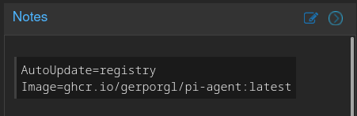

# proxmox-ct-autoupdate

Refresh the rootfs of selected Proxmox LXC containers from an OCI image whenever
the image digest in a registry changes.

Containers **opt in explicitly** through a fenced code block in their container
config. Everything else is skipped silently — no snapshot, no stop, no wipe.

> The update is destructive by design: the container rootfs is wiped and replaced
> by the image content. A ZFS snapshot is taken first and rolled back automatically
> on failure.
>
> **Everything under the container rootfs is ephemeral** — including credentials Proxmox
> itself created for you (`pct create --password`, `--root-password`, SSH keys you pushed
> in through the UI). Mount a second volume for anything that must survive
> (`mp0: local-zfs:subvol-<CTID>-disk-1,mp=/root`).

## Config example using Proxmox CT Notes:



## Requirements

Proxmox VE 9 (Debian 13) on ZFS, plus:

```sh
apt install skopeo umoci
# already present on any Proxmox install: pct, pvesm, zfs, bash, awk, flock, curl*
```

| tool | used for |
|---|---|
| `skopeo` | inspect the remote digest, copy the image to a local OCI layout |
| `umoci` | `umoci raw unpack` into the container rootfs |
| `zfs` (zfsutils-linux) | snapshot / rollback / dataset resolution |
| `pct`, `pvesm` (pve-manager) | container state, storage path cross-check |
| `curl` | only if you use the example ntfy notification hook |

Only **ZFS backed rootfs** (`zfspool`, and the legacy `zfs` storage type) is
supported. Anything else is skipped.

## Quick start

```sh
# 1. install
install -m 0755 pve-ct-autoupdate.sh /usr/local/bin/pve-ct-autoupdate.sh

# 2. see what would be picked up and how the rootfs is resolved
/usr/local/bin/pve-ct-autoupdate.sh --list

# 3. dry run (no changes at all, prints the commands)
/usr/local/bin/pve-ct-autoupdate.sh --dry-run

# 4. real run
/usr/local/bin/pve-ct-autoupdate.sh
```

## Opt-in container config

### Recommended: the Proxmox UI *Summary* field

Container → **Summary** tab. Type the block normally, **without any `#`** — Proxmox
stores the summary as comment lines and prefixes them itself:

````md
```
AutoUpdate=registry
Image=registry.example.com/org/app:latest
```
````

This shows up in `/etc/pve/lxc/<CTID>.conf` as:

```
#```
#AutoUpdate=registry
#Image=registry.example.com/org/app:latest
#```
```

The summary keeps working as before: any other text, notes or markdown you put there
is simply ignored, only the fenced block is parsed. No SSH needed — opt in for a
container entirely from the web UI.

### Or: edit the config file directly

Add the same block (with the `#` prefixes) at the top of `/etc/pve/lxc/<CTID>.conf`,
or use `pvesh set -f /nodes/<node>/<qemu|lxc>/<ctid>` — see `examples/ct-conf.example`.

Parsing is strict:

- only lines starting with `#` are considered (that is what Proxmox writes for the
  summary), the fenced block must be complete (exactly one opening and one closing
  ``` fence, ```` ```md ```` also accepted)
- `AutoUpdate` must be exactly `registry` — anything else disables the container
- `Image` is required, the **tag is mandatory** (`app` is rejected, `app:latest` is fine)
- `%3A` style URL encoding of `:` is decoded, an optional `docker://` prefix is accepted
- keys outside the fence are ignored, unknown keys inside the fence are ignored
- optional key: `SnapshotKeep=N` (per container override)

A container whose block is missing or malformed is never touched.

## What happens per container

1. `skopeo inspect` → remote digest. Identical to the stored digest → done, no notification.
2. `skopeo copy` into the local OCI staging dir. **A pull failure never touches the rootfs.**
3. `pct stop` if the container is running (already-stopped containers stay stopped).
4. `zfs snapshot <dataset>@autoupdate-<timestamp>`
5. `find <rootfs> -xdev -mindepth 1 -delete` (extra `mpN:` mounts are not crossed)
6. `umoci raw unpack` (uid/gid map `0:100000:65536` for `unprivileged: 1`)
7. `pct start` if it was running, then a status sanity check
8. store the new digest, prune snapshots, clean the staging dir

**Rollback:** any failure at or after the wipe triggers `zfs rollback -f` on the
snapshot, restarts the container if it had been running, sends an error notification,
does **not** commit the digest, and stops processing further containers. Failures
before the snapshot (pull, stop, snapshot creation) leave the rootfs untouched and
processing continues with the next container.

## How the rootfs path is resolved

The path is never assumed. Proxmox has moved ZFS subvol layouts between versions
(`<pool>/subvol-<ctid>-disk-N` vs the legacy `<pool>/data/subvol-...`), so:

1. `rootfs:` is parsed from the container config → `<storage>:<volid>`
2. the volume must be `subvol-<CTID>-disk-N`
3. `/etc/pve/storage.cfg` must define that storage as `zfspool` (or legacy `zfs`)
4. ZFS itself is asked which dataset holds the volume (`zfs list -o name,mountpoint`)
5. the dataset must be a **filesystem** (not a zvol), mounted, and the directory that
   will be wiped must be *exactly* that dataset's mountpoint
   (`zfs list -o name -d 0 <path>` must return the same dataset)
6. `pvesm path <storage>:<volid>` is used as a cross-check; a disagreement aborts

Containers whose dataset does not exist on this node (cluster configs are global)
are skipped quietly.

## Options

```
--dry-run          print what would run, change nothing (read-only queries still run)
--list             show opted-in containers + resolved dataset/rootfs, no changes
--ctid <id>        limit the run to this CTID (repeatable)
--force            apply the update even when the digest did not change
--verbose          debug logging
--state-dir DIR    default /var/lib/pve-ct-autoupdate
--oci-dir DIR      default <state-dir>/oci
--snapshot-keep N  default 0 (remove the temporary snapshot after success)
--version, --help
```

Environment overrides:

| variable | default |
|---|---|
| `PVE_AUTOUPDATE_LXC_DIR` | `/etc/pve/lxc` |
| `PVE_AUTOUPDATE_STORAGE_CFG` | `/etc/pve/storage.cfg` |
| `PVE_AUTOUPDATE_STATE_DIR` | `/var/lib/pve-ct-autoupdate` |
| `PVE_AUTOUPDATE_DIGEST_DIR` | `<state-dir>/digest` |
| `PVE_AUTOUPDATE_OCI_DIR` | `<state-dir>/oci` |
| `PVE_AUTOUPDATE_LOCK_DIR` | `/var/lock` |
| `PVE_AUTOUPDATE_SNAPSHOT_KEEP` | `0` |
| `PVE_AUTOUPDATE_SNAPSHOT_PREFIX` | `autoupdate` (ZFS snapshot names are limited to 32 chars) |
| `PVE_AUTOUPDATE_IDMAP` | `0:100000:65536` |
| `PVE_AUTOUPDATE_NOTIFY_CMD` | auto-detected hook (see below) |
| `PVE_AUTOUPDATE_VERBOSE`, `PVE_AUTOUPDATE_DRY_RUN` | `0` |

The state dir holds only the last applied digest per CTID
(`<state-dir>/digest/<ctid>.digest`). The OCI staging dir lives on real disk
(not tmpfs) because images can be several GB. A per-CTID `flock` prevents
overlapping runs.

## Notifications

Optional. If a hook exists it is called as:

```
<hook> <severity> <title> <message>     # severity: info | warning | error
```

Lookup order: `$PVE_AUTOUPDATE_NOTIFY_CMD`, `notify.sh` next to the script,
`/usr/local/bin/pve-ct-autoupdate-notify.sh`.

You only get notified when a container was actually updated, when a run failed,
or when an opted-in container could not be inspected. A cron run with nothing to
do sends nothing. `examples/notify.sh` is an ntfy (or any HTTP) example:

```sh
install -m 0755 examples/notify.sh /usr/local/bin/pve-ct-autoupdate-notify.sh
```

## Cron

```sh
install -m 0644 examples/crontab /etc/cron.d/pve-ct-autoupdate
```

See `examples/crontab`.

## Tests

Self-contained, no Proxmox/ZFS/registry needed — `tests/mockbin/` provides fake
`pct`, `zfs`, `skopeo`, `umoci` and `pvesm` driven by flat fixture files:

```sh
./tests/run-tests.sh
```

Covers: digest unchanged, opt-in parsing (missing/unterminated/invalid block,
missing tag, unknown keys), non-ZFS storage, modern *and* legacy ZFS layouts,
mountpoint mismatch, foreign cluster nodes, stopped containers, pull failure
(no rollback, keeps going), unpack failure (rollback + abort), snapshot pruning
with `SnapshotKeep`, privileged vs unprivileged id mapping, `--dry-run` and
`--list`.

## Limitations

- ZFS backed rootfs only.
- The rootfs is fully **ephemeral by design**: any file inside it (shell profile,
  `~/.ssh/authorized_keys`, local config, …) is deleted on the next update — **including
  the root password and SSH keys Proxmox wrote when the container was created**, since
  those live in `/etc/shadow` and `/root/.ssh` on the rootfs. Only the `mpN:` extra
  mounts survive. Bake what matters into the image, or mount a dedicated subvolume:

  ```
  mp0: local-zfs:subvol-100-disk-1,mp=/data,backup=1,size=64G
  ```

  Prefer images that re-create their own defaults when the mounted directory is empty,
  so the container is usable again right after an update.
- Snapshot-based rollback only covers the rootfs dataset: extra `mpN:` mounts are
  deliberately never touched, so data there is **not** rolled back.
- Registry authentication uses whatever `skopeo auth.json` provides; there is no
  built-in credential handling and no TLS-verify bypass switch.
- Image refs must carry a tag; `@sha256:` pinned refs are not accepted (the digest
  comparison is what drives the update).
- `latest` is allowed, but a mutable tag means an update is applied on every push.
